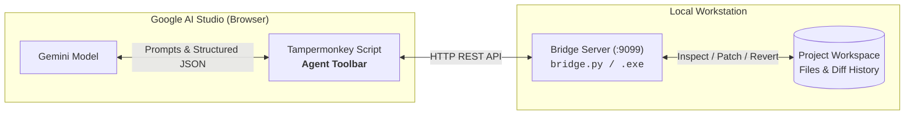

# AI Studio Agent

[](https://github.com/jonson-zero/ai-studio-agent/releases)
[](https://www.python.org/downloads/)

Local filesystem bridge (Coding Agent) for Google AI Studio. Connects web-based Gemini models directly to your local project directory via a userscript and a local HTTP daemon, enabling automated multi-turn file inspection, patching, and rollback without API token costs.

*Originally developed for Godot 4, it has evolved into a general-purpose coding assistant.*

---

> [!IMPORTANT]
> - **Error compounding and repetition loops:** If the model enters a token generation loop or produces invalid JSON syntax, **regenerate the response immediately or start a new chat session**. Once corrupted output or parse errors enter the context window, the model tends to repeat the syntax failure on subsequent turns.
> - This utility interfaces with Google AI Studio. According to [Google Terms of Service for Unpaid Services](https://aistudio.google.com/docs/terms#unpaid-services), inputs and generated outputs on the free tier may be reviewed by human annotators and used to train machine learning models. Do not pass proprietary intellectual property, production secrets, credentials, or personal data through the prompt interface. Users in the EEA, Switzerland, and UK are governed by paid data protection terms even on unpaid tiers.

---

## Architecture



---

## Technical Capabilities

- **Zero API Metering:** Executes entirely through standard web chat quotas in Google AI Studio.
- **Surgical Patch Engine:** Supports micro-anchor search/replace, line-indentation alignment, full overwrite, append, and deletion (guarded by browser confirmation).
- **ReAct Inspection Loop:** The model can inspect local workspace files prior to modifying code. In `Auto` mode, file retrieval and patch applications execute autonomously.
- **Atomic Transaction Logging:** Records diffs for every change set, allowing isolated single-file reverts or chronological cascade rollbacks.
- **Preset Profiles:** Preconfigured profiles for Godot 4 (GDScript AST signatures, headless syntax validation) and generic software development. Custom presets can define file filters and syntax validation commands.
- **Zero Dependencies:** Pure Python standard library implementation.

---

## Installation

### 1. Browser Extension
1. Install [Tampermonkey](https://www.tampermonkey.net/) in your browser.
2. Install the userscript from [**agent.user.js**](https://raw.githubusercontent.com/jonson-zero/ai-studio-agent/main/agent.user.js).

### 2. Local Bridge Server

**Windows Standalone:**  
Download and run `ai-studio-agent.exe` from [Releases](https://github.com/jonson-zero/ai-studio-agent/releases/latest).

**From Source:**
```bash
git clone https://github.com/jonson-zero/ai-studio-agent.git
cd ai-studio-agent
python3 bridge.py
```

---

## Usage

1. Launch `bridge.py` (or the executable) and select your target workspace directory in the local web dashboard (`http://127.0.0.1:9099`).
2. Navigate to [Google AI Studio](https://aistudio.google.com/) and sign in.
3. In the floating toolbar:
   - Verify the connection status is green (**Online**).
   - Toggle **Agent: OFF** to **Agent: ON** to synchronize the system instructions and JSON output schema.
   - *(Optional)* Enable **Auto** to automatically apply changes and resolve file inspection requests without manual clicks.
4. Submit your coding task.

---

## CLI Reference

```bash
python bridge.py [--port PORT] [--project PATH] [--preset PRESET_ID]
```

| Flag | Type | Default | Description |
| :--- | :--- | :--- | :--- |
| `--port` | integer | `9099` | Server listening port |
| `--project` | string | `""` | Initial project workspace directory path |
| `--preset` | string | `"default"` | Active agent preset ID (`default`, `godot4`, etc.) |

---

## License

Distributed under the [MIT License](LICENSE).
